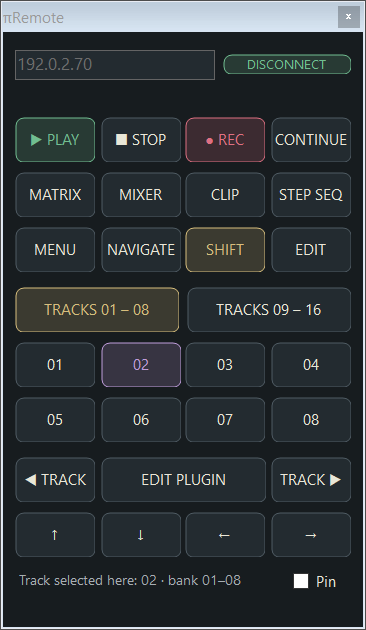

# πRemote

A compact transport and navigation companion for **Akai's official MPC Remote Screen**.

Keep Akai's screen, touch control and audio. Put πRemote beside it for PLAY, STOP, REC, track selection and the Force's hardware shortcuts.

**Force Gen1 · MPC OS 3.10.1 · Windows 10/11**

## Two packages

- **Force addin:** its own physical-button bridge and local command service. No Commander installation or MIDI port is required.
- **Windows app:** standalone native window, English UI, remembered IP, CONNECT/DISCONNECT, high-DPI rendering and Pin. WSL Ubuntu provides the SSH connection.

The official Remote Screen is a separate application from inMusic. πRemote does not bundle it and is not an inMusic product.

## First use

1. Enable official SSH access on the Force and configure SSH key access from WSL Ubuntu.
2. Extract the Force package on the device and run its `install.sh` after saving your project. See [INSTALL.md](INSTALL.md).
3. Extract the Windows package, run **πRemote.exe**, enter the Force IP and click **CONNECT**.
4. Open the official Remote Screen beside it.

If the addin is installed but inactive after a restart, CONNECT can offer activation. **It asks before restarting MPC**, because unsaved project changes would be lost. The app then runs the supplied PowerShell script. It never installs an addin silently.

## Commands

PLAY · STOP · REC · CONTINUE  
MATRIX · MIXER · CLIP · STEP SEQ  
MENU · NAVIGATE · SHIFT · EDIT  
Track groups 01–08 / 09–16 · EDIT PLUGIN · arrows

SHIFT and EDIT apply to the next press, then release. EDIT PLUGIN sends EDIT + the selected track button.

Track selection is tracked locally: if you change tracks or scroll the track group on the Force, verify the group and reselect a number here. The 09–16 bank and bank boundary need a device test with enough tracks. This is not a live project browser.

Transport mirrors physical Force buttons. REC toggles record arm; use PLAY to begin if stopped. CONTINUE uses the Force PLAY button at its current position. Green/red indicators follow remote and observed hardware button events, **not audio-engine telemetry**; touchscreen changes may not be reflected.

## Status

**0.1.0 — offline-tested; the exact standalone package is not yet device-validated.**

The earlier Commander-based prototype was user-validated on Force for PLAY, STOP, MATRIX and EDIT + the first two track buttons. That does not qualify this independent build as device-tested.

- ASan/UBSan parser, HTTP, transport and button-release tests pass.
- The real addin runs against a fake MPC/raw-MIDI host in integration tests.
- Upstream input-stream tests preserve partial messages, SysEx boundaries and running status.
- The native Windows app connects, disconnects and reconnects to the standalone test server without emitting transport or navigation commands.
- No CPU figure or reboot-persistence claim is made yet.

## Installation and persistence

The standard OpenMPC installer preserves other addins. It can support persistent writable overlays, including the stacked overlay used on some 3.10.1 systems, and falls back to runtime activation where required. Its result must be checked on the actual device. A firmware update may require reinstallation.

The fallback PowerShell reactivation is available from CONNECT after confirming the project is saved. See [Windows instructions](windows/README.md) and [Force installation](INSTALL.md).

## Build

Linux/WSL: `python3 build.py` runs sanitized tests and builds ARMv7 with a local cross-toolchain. Set `PIREMOTE_TOOLCHAIN_ROOT` to an extracted ARM hard-float GCC sysroot (the current builder uses GCC 12); otherwise the adjacent development toolchain is used.

Windows: `windows/Build-App.ps1` builds the native .NET Framework 4.8 app. It has no browser dependency. `python3 tests/windows_integration.py` connects the real Windows executable to the sanitized fake host in WSL.

`python3 package.py` creates the Force, Windows and source archives with checksums and provenance after those builds. The source archive excludes device settings, SSH keys, build products and personal IP addresses.

## Credits

The input stream hooks and JSON reader are reused under MIT from Jacob Sabella's projects. The standard addin installer is from OpenMPC. See [THIRD-PARTY.md](THIRD-PARTY.md), the pinned commits and the source licences. No Commander service is used or required.

πRemote uses no video capture, plugin polling or audio hook. The local command server is reached through a dedicated SSH tunnel, separate from the official viewer.
