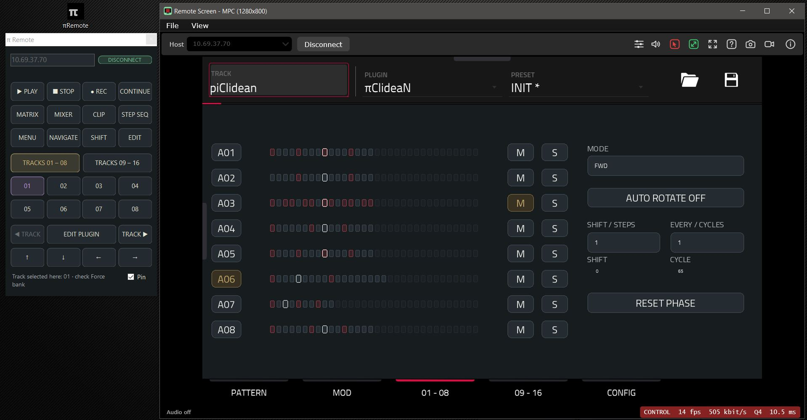

# πRemote 0.1.0

A compact Windows transport and navigation companion for the official Akai Remote Screen.

- Independent Force addin.
- PLAY, STOP, REC and CONTINUE; hardware view shortcuts, SHIFT/EDIT, track selectors and plugin editing.
- Windows panel with high-DPI rendering, remembered IP, one CONNECT/DISCONNECT button and Pin.
- Automatic startup after a full Force reboot, verified on the tested installation.
- Local command service reached through a dedicated SSH tunnel; no video capture, plugin polling or audio hook.

**Downloads:** install the ARMv7 ZIP on Force Gen1 OS 3.10.1, and extract the Windows ZIP on the PC. Windows requires .NET Framework 4.8, WSL Ubuntu and SSH key access. The official Remote Screen remains separate.

The standalone runtime has been user-tested on Force OS 3.10.1.12. Runtime checksum, operation without Commander and automatic activation after a full reboot were verified. Offline sanitizer, fake-hardware, Windows connection lifecycle and package checks pass. The catalogue listing is requested as Listed, not Verified.

Track state is local to the remote; verify the visible bank after using the Force itself. Bank 09–16 and the 08/09 boundary still need a dedicated device test with enough tracks. Transport indicators follow button events rather than audio-engine state. See VALIDATION.md for remaining checks.

The package check reports two expected warnings: GLIBC 2.34 (OS 3.x only) and networking for manual review. The server binds to 127.0.0.1 by default. No device CPU benchmark is claimed.

